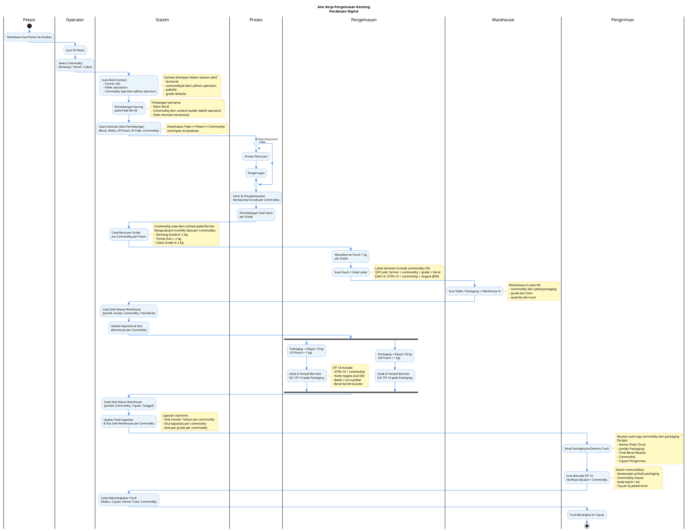
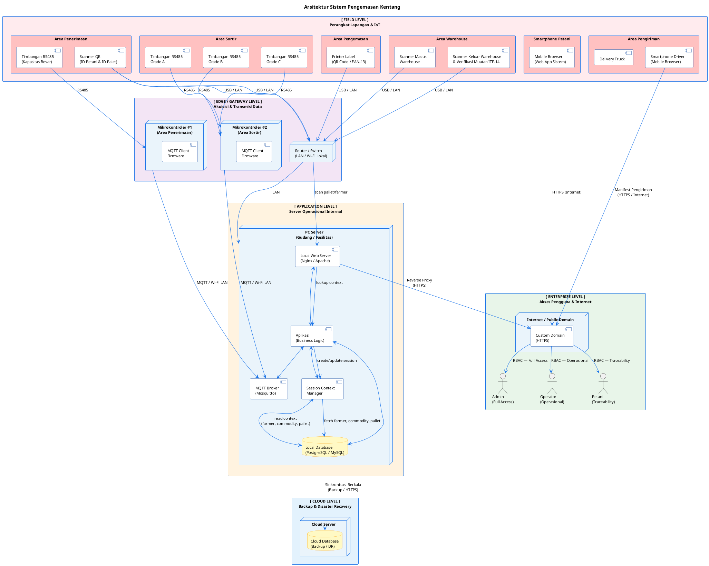

# Diagram Alur Kerja — Proses Pengemasan Kentang
## Pendataan Digital & Lokasi-Berbasis Wadah

## Workflow

---

---

> **Referensi:** Diagram Proses Pengemasan Kentang — *Pendataan Digital & Lokasi-Berbasis Wadah*

---

## Deskripsi Alur Kerja

### 1. Penerimaan & Verifikasi Petani
Petani datang membawa hasil panen ke fasilitas. ID Petani di-scan menggunakan perangkat (tablet/scanner). Sistem menampilkan data farmer:
- Nama petani
- Lokasi kebun
- Riwayat setoran

### 2. Penimbangan Pertama (Penerimaan) + Pemilihan Commodity
Karung hasil panen ditimbang di atas palet yang memiliki ID unik. Saat penimbangan pertama:
1. Operator scan ID petani
2. Operator **memilih commodity** yang ditimbang (Kentang / Tomat / Cabai / dll.)
3. Operator input berat dari timbangan
4. Sistem menyimpan:
   - Berat dari sensor
   - Waktu sekarang
   - ID Petani (dari scan)
   - ID Palet
   - **Commodity** (dari pilihan operator)
5. Palet terhubung langsung dengan farmer dan commodity

> **Catatan**: Commodity dipilih operator karena petani bisa menyetorkan berbagai jenis hasil panen. Pilihan ini menjadi **context** untuk semua langkah berikutnya.

### 3. Proses Pencucian *(Opsional)*
Berdasarkan kondisi komoditas, dilakukan keputusan apakah perlu pencucian atau tidak:
- **Ya** → Komoditas melalui proses pencucian dan pengeringan sebelum lanjut ke tahap berikutnya.
- **Tidak** → Komoditas langsung menuju proses sortir.

### 4. Sortir & Pengelompokan Grade per Commodity
Komoditas disortir dan dikelompokkan berdasarkan ukuran dan kualitas sesuai standar commodity:
- **Kentang**: Grade A, B, C
- **Tomat**: Size L, M, S
- **Cabai**: Grade A, B, C

Hasil sortir per grade ditimbang kembali. Saat penimbangan kedua/scan kedua:
- Operator **hanya pilih grade** dan **input berat**
- **Commodity otomatis terisi** dari context penimbangan pertama
- Sistem hitung total per grade per commodity per farmer

### 5. Pengemasan Pouch 1 kg
Komoditas dimasukkan ke dalam pouch transparan berukuran **1 kg per pouch**. Setiap pouch ditempeli label dengan dua jenis kode:
- **QR Code** — untuk traceabilitas internal (ID Petani, Lokasi Kebun, Tanggal Panen, **Commodity**, Grade, Berat)
- **EAN-13 Barcode** — standar GS1 internasional untuk kebutuhan ritel dan ekspor (GTIN-13 + **commodity code** + kode negara Indonesia `899`)

### 6. Penyimpanan di Warehouse
Pouch yang sudah berlabel disimpan di warehouse. Saat warehouse in:
- Operator scan pallet/packaging
- Sistem otomatis:
  - Ambil commodity dari palet/pouch
  - Ambil grade dari item
  - Hitung quantity dan total berat
  - Update stok warehouse per commodity + grade
- Sistem mencatat stok masuk (jumlah pouch, grade, commodity, total berat) dan memperbarui kapasitas serta sisa ruang warehouse secara real-time.

### 7. Pengemasan Ekspor (Packaging)
Pouch dikemas ulang ke dalam packaging untuk keperluan ekspor dalam dua ukuran yang diproses secara paralel:
- **Packaging 10 kg** — berisi 10 pouch × 1 kg
- **Packaging 50 kg** — berisi 50 pouch × 1 kg

Setiap packaging ditempeli label **GS1 ITF-14 Barcode** yang merupakan standar barcode internasional untuk kemasan logistik, memuat GTIN-14, kode negara asal, **commodity code**, nomor batch/lot, serta berat bersih dan kotor.

### 8. Pengiriman (Delivery Truck)
Packaging ekspor dimuat ke delivery truck. Sebelum berangkat, barcode ITF-14 pada setiap packaging di-scan ulang untuk **verifikasi muatan** — memastikan kesesuaian jumlah packaging, **commodity**, kode batch, dan tujuan pengiriman. Sistem mencatat waktu keberangkatan, tujuan, nomor polisi truck, dan commodity. Stok keluar warehouse diperbarui secara otomatis per commodity.

---

### Ringkasan Standar Barcode

| Kemasan | Jenis Barcode | Standar | Fungsi |
|---------|--------------|---------|--------|
| Pouch 1 kg | QR Code | Internal | Traceabilitas petani, commodity & produk |
| Pouch 1 kg | EAN-13 | GS1 Ritel | Identifikasi produk ritel/ekspor + commodity |
| Packaging 10 kg / 50 kg | ITF-14 | GS1 Logistik | Identifikasi kemasan logistik ekspor + commodity |

### Ringkasan Swimlane

| Lane | Peran |
|------|-------|
| **Petani** | Membawa panen, scan ID, penimbangan |
| **Operator** | Scan pallet/farmer → input berat saja → sistem auto-fill commodity + grade |
| **Sistem** | Auto-fetch context, pencatatan otomatis, validasi, pembaruan stok & kapasitas per commodity |
| **Proses** | Pencucian (opsional), sortir grade per commodity, penimbangan hasil sortir |
| **Pengemasan** | Pengisian pouch, pelabelan, pengemasan packaging ekspor |
| **Warehouse** | Penyimpanan pouch, manajemen stok masuk/keluar per commodity |
| **Pengiriman** | Loading truck, verifikasi muatan + commodity, keberangkatan |

---

## 2. Diagram Arsitektur Sistem

> Diagram arsitektur sistem diurutkan dari **Field Level** (perangkat lapangan) hingga **Enterprise Level** (akses pengguna & internet).

---

### Penjelasan Layer Arsitektur

| Layer | Komponen | Fungsi |
|-------|----------|--------|
| **Field Level** | Timbangan RS485, Scanner QR, Printer Label, Scanner Warehouse, Scanner Pengiriman, Smartphone Petani | Perangkat fisik di lapangan untuk input data, pengemasan, dan pengiriman |
| **Edge / Gateway** | Mikrokontroler ×2, Router/Switch | Akuisisi data dari timbangan via RS485, transmisi ke server via MQTT |
| **Application Level** | PC Server (Web Server + App + MQTT Broker + Session Context + DB) | Pusat logika bisnis, session context management, dan penyimpanan lokal |
| **Cloud Level** | Cloud Database | Backup berkala dan disaster recovery |
| **Enterprise Level** | Custom Domain (HTTPS), Admin, Operator, Petani | Akses publik berbasis RBAC melalui internet |

### Protokol Komunikasi

| Koneksi | Protokol | Keterangan |
|---------|----------|------------|
| Timbangan → Mikrokontroler | **RS485** | Serial wired, andal untuk jarak pendek di lingkungan industri |
| Mikrokontroler → PC Server | **MQTT** | Lightweight, real-time, ideal untuk IoT over LAN/Wi-Fi |
| Scanner / Printer → PC | **USB / LAN** | Koneksi langsung ke jaringan lokal |
| PC Server → Cloud | **HTTPS** | Sinkronisasi berkala database ke cloud backup |
| Pengguna → Aplikasi | **HTTPS** | Akses web aman via custom domain (internet) |

### Manajemen Akses (RBAC)

| Role | Hak Akses |
|------|-----------|
| **Admin** | Penuh — konfigurasi sistem, laporan, manajemen pengguna |
| **Weighing Operator** | Operasional penimbangan — scan ID, verifikasi timbangan, input berat, create pallet |
| **Sorting Operator** | Operasional penyortiran — grading, buat pouch, cetak label |
| **Warehouse Operator** | Operasional gudang — warehouse in/out, stok management |
| **Delivery Operator** | Operasional pengiriman — packaging, delivery, cetak dokumen |
| **Petani** | Terbatas — riwayat setoran, validasi data panen, traceability |

---

## 3. Diagram Skema Database

```plantuml
@startuml Database_Schema

skinparam BackgroundColor #FAFAFA
skinparam ArrowColor #1A73E8
skinparam ArrowFontName Arial
skinparam DefaultFontName Arial
skinparam DefaultFontSize 11

title Skema Database — ENYX-Smart Hub\n(Multi-Commodity)

' ============================================================
' CORE MODELS
' ============================================================

entity "Commodity" as commodity {
  *id : UUID <<PK>>
  --
  *name : VARCHAR <<UNIQUE>>
  description : TEXT
  *unit : VARCHAR <<DEFAULT: kg>>
  createdAt : TIMESTAMP
}

entity "User" as user {
  *id : UUID <<PK>>
  --
  *email : VARCHAR <<UNIQUE>>
  *name : VARCHAR
  *password : VARCHAR
  *role : ENUM <<DEFAULT: OPERATOR>>
  createdAt : TIMESTAMP
  updatedAt : TIMESTAMP
}

entity "Farmer" as farmer {
  *id : UUID <<PK>>
  --
  *name : VARCHAR
  phone : VARCHAR
  address : TEXT
  location : VARCHAR
  *code : VARCHAR <<UNIQUE>>
  *userId : UUID <<FK>>
  createdAt : TIMESTAMP
  updatedAt : TIMESTAMP
}

entity "Pallet" as pallet {
  *id : UUID <<PK>>
  --
  *code : VARCHAR <<UNIQUE>>
  *farmerId : UUID <<FK>>
  *commodityId : UUID <<FK>>
  createdAt : TIMESTAMP
}

entity "Grade" as grade {
  *id : UUID <<PK>>
  --
  *name : VARCHAR <<UNIQUE>>
  description : TEXT
  *commodityId : UUID <<FK>>
  createdAt : TIMESTAMP
}

entity "WeighingRecord" as weighing {
  *id : UUID <<PK>>
  --
  *palletId : UUID <<FK>>
  gradeId : UUID <<FK>>
  *weightKg : FLOAT
  note : TEXT
  *recordedAt : TIMESTAMP
  *userId : UUID <<FK>>
}

entity "Pouch" as pouch {
  *id : UUID <<PK>>
  --
  *palletId : UUID <<FK>>
  *gradeId : UUID <<FK>>
  *qrCode : VARCHAR <<UNIQUE>>
  *ean13 : VARCHAR <<UNIQUE>>
  *weightKg : FLOAT <<DEFAULT: 1.0>>
  *commodityId : UUID <<FK>>
  createdAt : TIMESTAMP
}

entity "Warehouse" as warehouse {
  *id : UUID <<PK>>
  --
  *name : VARCHAR
  *capacity : INT
  createdAt : TIMESTAMP
  updatedAt : TIMESTAMP
}

entity "WarehouseStock" as stock {
  *id : UUID <<PK>>
  --
  *warehouseId : UUID <<FK>>
  *gradeId : UUID <<FK>>
  *quantity : INT
  *totalWeight : FLOAT
  createdAt : TIMESTAMP
  updatedAt : TIMESTAMP
}

' ============================================================
' PACKAGING MODELS (Generalized)
' ============================================================

entity "PackagingType" as pkg_type {
  *id : UUID <<PK>>
  --
  *code : VARCHAR <<UNIQUE>> <<CARTON, BOX, PALLET>>
  *name : VARCHAR
  description : TEXT
  createdAt : TIMESTAMP
}

entity "PackagingSize" as pkg_size {
  *id : UUID <<PK>>
  --
  *typeId : UUID <<FK>>
  *code : VARCHAR <<UNIQUE>> <<10KG, 50KG, STD>>
  *name : VARCHAR
  *capacity : INT
  *unit : VARCHAR <<DEFAULT: pouch>>
  createdAt : TIMESTAMP
}

entity "PackagingUnit" as pkg_unit {
  *id : UUID <<PK>>
  --
  *sizeId : UUID <<FK>>
  *barcode : VARCHAR <<UNIQUE>> <<ITF-14, GS1-128>>
  batchNo : VARCHAR
  totalWeight : FLOAT
  *commodityId : UUID <<FK>>
  *status : VARCHAR <<DEFAULT: ACTIVE>>
  createdAt : TIMESTAMP
}

entity "PackagingItem" as pkg_item {
  *id : UUID <<PK>>
  --
  *packagingId : UUID <<FK>>
  *itemId : VARCHAR
  *itemType : VARCHAR <<POUCH, UNIT>>
  createdAt : TIMESTAMP
}

entity "PackagingDelivery" as pkg_delivery {
  *id : UUID <<PK>>
  --
  *packagingId : UUID <<FK>>
  *deliveryId : UUID <<FK>>
  createdAt : TIMESTAMP
}

' ============================================================
' DELIVERY & TIME SERIES
' ============================================================

entity "Delivery" as delivery {
  *id : UUID <<PK>>
  --
  *truckPlate : VARCHAR
  *destination : VARCHAR
  driverName : VARCHAR
  *commodityId : UUID <<FK>>
  departedAt : TIMESTAMP
  createdAt : TIMESTAMP
}

entity "ScaleReading" as scale {
  *time : TIMESTAMP <<PK>>
  *deviceId : VARCHAR <<PK>>
  --
  weightKg : FLOAT
  palletId : UUID <<FK>>
  commodityId : UUID <<FK>>
  raw : JSON
}

' ============================================================
' RELATIONSHIPS
' ============================================================

' Commodity relationships
commodity ||--o{ pallet : "has many"
commodity ||--o{ grade : "has many"
commodity ||--o{ pouch : "has many"
commodity ||--o{ stock : "has many"
commodity ||--o{ pkg_unit : "has many"
commodity ||--o{ delivery : "has many"
commodity ||--o{ scale : "has many"

' User relationships
user ||--o{ farmer : "has profile"
user ||--o{ weighing : "records"

' Farmer relationships
farmer ||--o{ pallet : "has many"

' Pallet relationships
pallet ||--o{ weighing : "has many"
pallet ||--o{ pouch : "has many"

' Grade relationships
grade ||--o{ weighing : "has many"
grade ||--o{ pouch : "has many"
grade ||--o{ stock : "has many"

' Weighing relationships
weighing }|--|| pallet : "belongs to"
weighing }|--o| grade : "belongs to"
weighing }|--|| user : "recorded by"

' Pouch relationships
pouch }|--|| pallet : "belongs to"
pouch }|--|| grade : "belongs to"
pouch ||--o{ pkg_item : "packed in"

' Warehouse relationships
warehouse ||--o{ stock : "has many"
stock }|--|| warehouse : "belongs to"
stock }|--|| grade : "belongs to"

' Packaging Type relationships
pkg_type ||--o{ pkg_size : "has many"
pkg_type ||--o{ pkg_unit : "has many"

' Packaging Size relationships
pkg_size }|--|| pkg_type : "belongs to"
pkg_size ||--o{ pkg_unit : "has many"

' Packaging Unit relationships
pkg_unit }|--|| pkg_size : "belongs to"
pkg_unit }|--|| commodity : "belongs to"
pkg_unit ||--o{ pkg_item : "contains"
pkg_unit ||--o{ pkg_delivery : "shipped via"

' Packaging Item relationships
pkg_item }|--|| pkg_unit : "belongs to"

' Packaging Delivery relationships
pkg_delivery }|--|| pkg_unit : "belongs to"
pkg_delivery }|--|| delivery : "belongs to"

' Delivery relationships
delivery ||--o{ pkg_delivery : "contains"

' Scale Reading relationships
scale }|--o| pallet : "references"

@enduml
```

---

### Penjelasan Skema Database

#### 1. Core Models (Inti)

| Tabel | Fungsi | Relasi |
|-------|--------|--------|
| `commodities` | Master data commodity (kentang, tomat, cabai) | 1 → N ke semua tabel bisnis |
| `users` | User accounts (admin, operator, farmer) | 1 → 1 ke farmer profile |
| `farmers` | Data petani | N → 1 ke user |
| `pallets` | Palet pembawa hasil panen | N → 1 ke farmer, N → 1 ke commodity |
| `grades` | Grade kualitas (A/B/C) per commodity | N → 1 ke commodity |
| `weighing_records` | Data timbangan | N → 1 ke pallet, grade, user |
| `pouches` | Pouch 1 kg setelah grading | N → 1 ke pallet, grade, commodity |
| `warehouses` | Master warehouse | 1 → N ke stock |
| `warehouse_stock` | Stok warehouse per grade | N → 1 ke warehouse, grade |

#### 2. Packaging Models (Generalized)

| Tabel | Fungsi | Relasi |
|-------|--------|--------|
| `packaging_types` | Tipe pengemas (CARTON, BOX, PALLET) | 1 → N ke sizes & units |
| `packaging_sizes` | Ukuran pengemas (10KG, 50KG, STD) | N → 1 ke type, 1 → N ke units |
| `packaging_units` | Unit pengemas konkret dengan barcode | N → 1 ke size, commodity |
| `packaging_items` | Relasi item ke packaging unit | N → 1 ke packaging unit |
| `packaging_deliveries` | Relasi packaging ke delivery | N → 1 ke packaging & delivery |

#### 3. Delivery & Time Series

| Tabel | Fungsi | Relasi |
|-------|--------|--------|
| `deliveries` | Data pengiriman truck | 1 → N ke packaging_deliveries |
| `scale_readings` | Data timbangan real-time dari MQTT | Time-series hypertable |

#### 4. Index & Constraints

- **Primary Keys**: Semua tabel menggunakan UUID
- **Unique Constraints**: `code` (farmer, pallet), `qrCode`, `ean13`, `barcode`
- **Composite Keys**: `scale_readings` menggunakan `(time, deviceId)`
- **Foreign Keys**: Semua relasi menggunakan UUID dengan cascade rules
- **Check Constraints**: `status` enum untuk packaging units

#### 5. Multi-Commodity Support

Setiap tabel bisnis memiliki `commodityId` yang mengacu ke tabel `commodities`. Ini memungkinkan:
- Petani bisa menyetorkan berbagai jenis hasil panen
- Setiap commodity punya grading system sendiri
- Warehouse stock di-track per commodity
- Packaging configuration per commodity
- Delivery per commodity

#### 6. QR/Barcode Code Standards

Semua identifier yang discan di lapangan mengikuti format standar berikut:

**Farmer Code** — Format: `FRM-{YYYY}-{SEQ}`
- `FRM`: prefix farmer
- `{YYYY}`: tahun registrasi, contoh `2026`
- `{SEQ}`: nomor urut 4 digit, contoh `0001`
- Contoh: `FRM-2026-0001`
- Generate: Sistem auto-generate saat farmer didaftarkan
- Used in: QR Code pada ID card petani

**Pallet Code** — Format: `PLT-{YYYYMMDD}-{SEQ}`
- `PLT`: prefix pallet
- `{YYYYMMDD}`: tanggal dibuat, contoh `20260914`
- `{SEQ}`: nomor urut 4 digit per hari, contoh `0001`
- Contoh: `PLT-20260914-0001`
- Generate: Sistem auto-generate saat pallet dibuat
- Used in: QR Code pada palet

**Pouch QR Code** — Format: `PCH-{PALLET_CODE}-{SEQ}`
- `PCH`: prefix pouch
- `{PALLET_CODE}`: kode pallet sumber, contoh `PLT-20260914-0001`
- `{SEQ}`: nomor urut pouch dalam pallet, contoh `001`
- Contoh: `PCH-PLT-20260914-0001-001`
- Generate: Sistem auto-generate saat pouch dibuat dari pallet
- Used in: QR Code pada label pouch 1 kg

**Pouch EAN-13** — Format: `899{COMMODITY_CODE}{SEQ}`
- `899`: kode negara Indonesia (GS1)
- `{COMMODITY_CODE}`: 3 digit commodity code, contoh `001` untuk Kentang
- `{SEQ}`: 6 digit nomor urut unik global
- Contoh: `899001000001`
- Generate: Sistem auto-generate saat pouch dibuat
- Used in: EAN-13 barcode pada label pouch

**Packaging Barcode (ITF-14)** — Format: `{GTIN-14}`
- GTIN-14: 14 digit yang includes:
  - 1 digit packaging indicator (0 untuk inner, 1 untuk case)
  - 3 digit commodity code
  - 5 digit batch/lot number
  - 5 digit sequence
- Contoh: `000189700100011`
- Generate: Sistem auto-generate saat packaging unit dibuat
- Used in: ITF-14 barcode pada packaging ekspor

**Commodity Code Mapping** (3 digit):
- `001`: Kentang
- `002`: Tomat
- `003`: Cabai
- Ditambahkan secara dinamis saat commodity baru dibuat

---

## 📚 Related Documentation

- `API.md` — Complete API endpoint registry with OpenAPI/Swagger documentation
- `TECH_STACK.md` — Technology choices and database schema
- `ARCHITECTURE.md` — Module architecture and responsibilities
- `PLANNING.md` — Implementation phases and task breakdown
