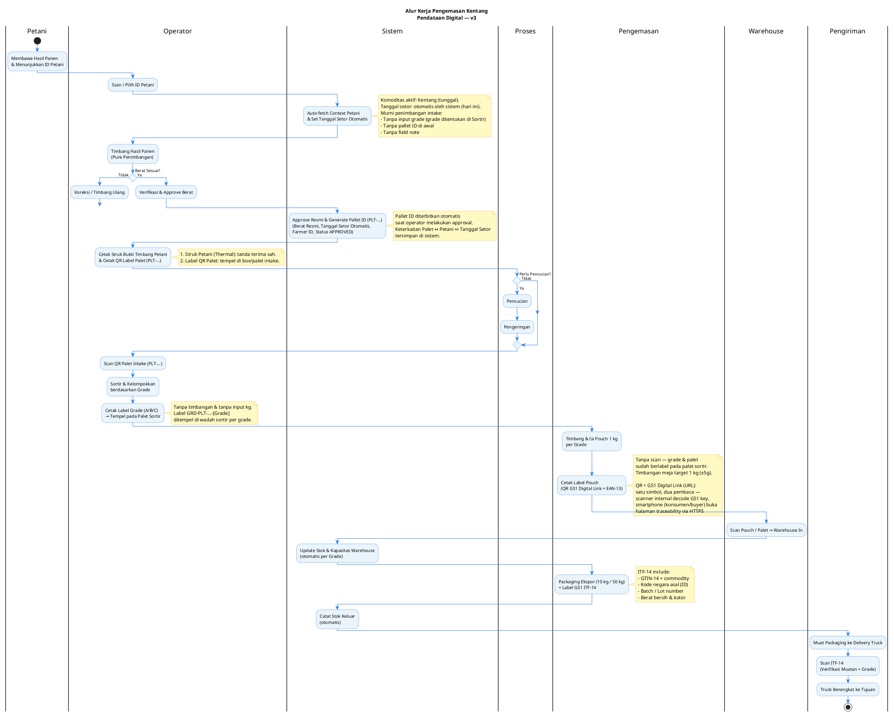
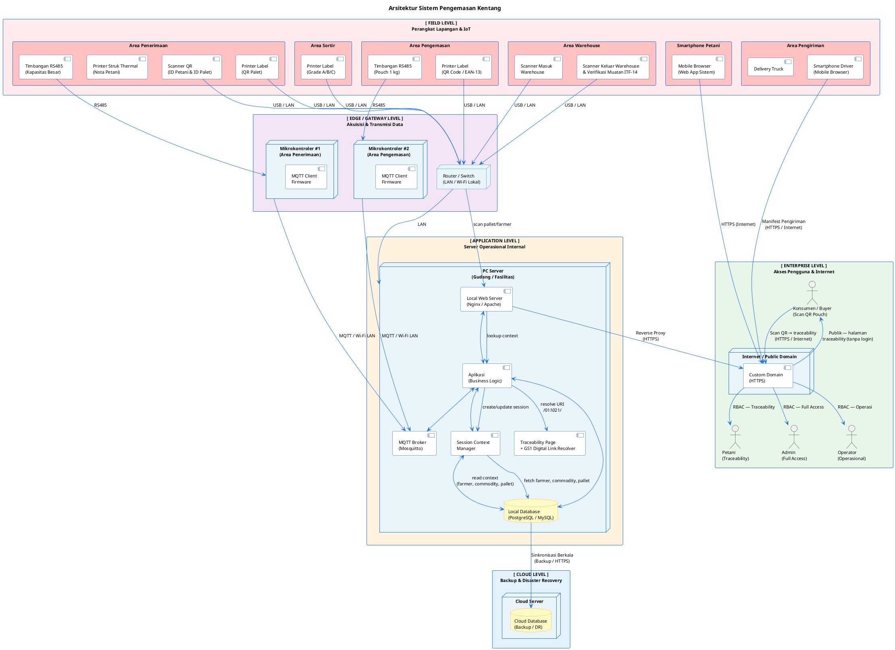

# Diagram Alur Kerja — Proses Pengemasan Kentang
## Pendataan Digital & Lokasi-Berbasis Wadah

## Workflow

---

---

> **Referensi:** Diagram Proses Pengemasan Kentang — *Pendataan Digital & Lokasi-Berbasis Wadah*

---

## Deskripsi Alur Kerja

> **Aturan penimbangan**: penimbangan hanya dilakukan di **Area Penerimaan** (timbang karung per palet) dan **Area Pengepakan** (timbang pouch 1 kg per grade). Area Sortir tidak memiliki timbangan.

### 1. Penerimaan — *Area Penerimaan*
**Fungsi**: Operator scan/pilih ID petani untuk menetapkan konteks intake. Pada halaman penimbangan, operator murni hanya menimbang hasil panen saja (Auto detect via Modbus TCP/MQTT atau input Manual). Tanggal setor dicatat otomatis oleh sistem tanpa input manual tanggal panen. Tidak ada input grade, pallet ID, maupun note saat proses penimbangan. Operator memeriksa pembacaan berat; jika belum sesuai dapat dilakukan koreksi/timbang ulang, jika sudah sesuai operator melakukan verifikasi & approve berat resmi. Setelah berat di-approve, sistem secara otomatis menerbitkan Pallet ID (`PLT-…`) berstatus `APPROVED` dan membuka langkah cetak ganda: Struk Bukti Timbang Petani (sebagai nota tanda terima sah untuk dibawa pulang petani) dan QR label palet untuk ditempelkan pada box/palet sebelum dialirkan ke tahap sortir.

**Tujuan**: Menetapkan berat setoran resmi secara murni, memberikan bukti fisik sah kepada petani, mencatat tanggal setor otomatis, dan menerbitkan identitas fisik palet ber-QR untuk penelusuran (traceability) tahap berikutnya.

### 2. Pencucian *(Opsional)*
**Fungsi**: Mencuci dan mengeringkan kentang bila kondisinya memerlukan; dilewati jika sudah bersih.

**Tujuan**: Membersihkan komoditas sebelum sortir agar hasil mutu tidak tercemar kotoran.

### 3. Sortir — *Area Sortir*
**Fungsi**: Operator scan QR label palet intake (`PLT-…`), memisahkan kentang ke grade A/B/C secara fisik, memilih grade hasil sortir, mencetak label grade (`GRD-PLT-…-[Grade]`), dan menempelkannya pada palet/keranjang sortir yang bersangkutan. Murni klasifikasi mutu tanpa penimbangan dan tanpa input form bobot kg.

**Tujuan**: Mengelompokkan mutu dan memberi identitas fisik palet per grade untuk pengepakan; berat per grade diperoleh dari akumulasi penimbangan pouch di Area Pengepakan.

### 4. Pengepakan — *Area Pengepakan*
**Fungsi**: Menimbang & mengisi pouch 1 kg per grade menggunakan timbangan meja (target 1 kg $\pm$ 5 g), lalu mencetak label pouch — QR Code **GS1 Digital Link** + EAN-13, tanpa scan, karena grade dan palet sudah berlabel pada kelompok sortir.

**Tujuan**: Menghasilkan unit retail 1 kg dengan berat akurat, identitas GS1, dan traceability; berat riil per grade dihitung dari akumulasi jumlah pouch. Satu simbol QR berfungsi ganda: scanner internal mendecode GS1 key, smartphone konsumen/buyer langsung membuka halaman traceability (petani, kebun, tanggal panen, grade, berat) via HTTPS.

### 5. Penyimpanan di Warehouse — *Area Warehouse*
**Fungsi**: Operator scan pouch/pallet saat warehouse in; sistem otomatis mencatat stok masuk (jumlah, grade, total berat) dan memperbarui kapasitas serta sisa ruang.

**Tujuan**: Menyimpan stok dalam status terdata dan real-time per grade.

### 6. Pengiriman (Delivery) — *Area Pengiriman*
**Fungsi**: Pouch ditarik dari warehouse dan dikemas menjadi packaging ekspor 10 kg / 50 kg dengan label ITF-14, dimuat ke truck, lalu barcode ITF-14 di-scan untuk verifikasi muatan (jumlah, grade, batch, tujuan). Keberangkatan dicatat dan stok keluar diperbarui otomatis.

**Tujuan**: Menyiapkan unit logistik ekspor berstandar GS1 dan memastikan muatan sesuai rencana pengiriman dengan stok keluar yang akurat.

---

### Ringkasan Standar Barcode

| Kemasan | Jenis Barcode | Standar | Fungsi |
|---------|--------------|---------|--------|
| Kelompok Grade (di palet) | QR/Barcode Grade | Internal | Identifikasi grade (A/B/C) per kelompok hasil sortir |
| Pouch 1 kg | QR GS1 Digital Link | GS1 Internal + Publik | Scanner internal decode GS1 key; smartphone konsumen buka halaman traceability |
| Pouch 1 kg | EAN-13 | GS1 Ritel | Identifikasi produk ritel/ekspor + commodity |
| Packaging 10 kg / 50 kg | ITF-14 | GS1 Logistik | Identifikasi kemasan logistik ekspor + commodity |

### Ringkasan Swimlane

| Lane | Peran |
|------|-------|
| **Petani** | Membawa panen, menunjukkan ID petani, menyerahkan hasil panen |
| **Operator** | Scan ID petani, timbang karung (Auto/Manual), verifikasi & approve, cetak struk petani & label palet; saat sortir: scan palet intake & cetak label grade (A/B/C) |
| **Sistem** | Auto-fetch context, pencatatan otomatis (status APPROVED), update stok & kapasitas, resolve GS1 Digital Link → halaman traceability publik |
| **Proses** | Pencucian (opsional), sortir & pengelompokan grade |
| **Pengemasan** | Timbang & isi pouch 1 kg per grade, cetak label (QR GS1 Digital Link + EAN-13) — tanpa scan, grade sudah terpisah di palet |
| **Warehouse** | Warehouse in (scan pouch/pallet), manajemen stok masuk/keluar |
| **Pengiriman** | Loading truck, verifikasi muatan + grade via ITF-14, keberangkatan |

---

## 2. Diagram Arsitektur Sistem

> Diagram arsitektur sistem diurutkan dari **Field Level** (perangkat lapangan) hingga **Enterprise Level** (akses pengguna & internet).

---

### Penjelasan Layer Arsitektur

| Layer | Komponen | Fungsi |
|-------|----------|--------|
| **Field Level** | Timbangan RS485 (penerimaan & pengemasan), Scanner QR, Printer Struk Thermal (nota petani), Printer Label (palet, grade, pouch), Scanner Warehouse, Scanner Pengiriman, Smartphone Petani | Perangkat fisik di lapangan untuk input data, cetak tanda terima, pengemasan, dan pengiriman |
| **Edge / Gateway** | Mikrokontroler ×2 (Area Penerimaan + Area Pengemasan), Router/Switch | Akuisisi data dari timbangan via RS485, transmisi ke server via MQTT |
| **Application Level** | PC Server (Web Server + App + MQTT Broker + Session Context + Traceability Page/GS1 Digital Link Resolver + DB) | Pusat logika bisnis, session context management, halaman traceability publik, dan penyimpanan lokal |
| **Cloud Level** | Cloud Database | Backup berkala dan disaster recovery |
| **Enterprise Level** | Custom Domain (HTTPS), Admin, Operator, Petani | Akses publik berbasis RBAC melalui internet |

### Protokol Komunikasi

| Koneksi | Protokol | Keterangan |
|---------|----------|------------|
| Timbangan → Mikrokontroler | **RS485** | Serial wired, andal untuk jarak pendek di lingkungan industri |
| Mikrokontroler → PC Server | **MQTT** | Lightweight, real-time, ideal untuk IoT over LAN/Wi-Fi |
| Scanner / Printer → PC | **USB / LAN** | Koneksi langsung ke jaringan lokal |
| PC Server → Cloud | **HTTPS** | Sinkronisasi berkala database ke cloud backup |
| Pengguna → Aplikasi | **HTTPS** | Akses web aman via custom domain (internet), termasuk halaman traceability publik untuk konsumen |

### Manajemen Akses (RBAC)

| Role | Hak Akses |
|------|-----------|
| **Admin** | Penuh — konfigurasi sistem, laporan, manajemen pengguna |
| **Weighing Operator** | Operasional penimbangan — scan ID petani, pure intake timbang hasil panen (Auto/Manual, tanggal setor otomatis), verifikasi/approve berat, cetak struk tanda terima petani & label QR palet |
| **Sorting Operator** | Operasional penyortiran — scan palet intake, grading mutu fisik, cetak label grade palet (murni tanpa timbang) |
| **Packing Operator** | Operasional pengemasan — timbang & isi pouch 1 kg (tanpa scan palet), cetak label pouch (QR GS1 Digital Link + EAN-13) |
| **Warehouse Operator** | Operasional gudang — warehouse in/out, stok management |
| **Delivery Operator** | Operasional pengiriman — packaging, delivery, cetak dokumen |
| **Petani** | Terbatas — riwayat setoran, validasi data panen, traceability |
| **Konsumen / Buyer** | Publik (tanpa login) — halaman traceability pouch via scan QR GS1 Digital Link |

---

## 3. Diagram Skema Database

```plantuml
@startuml Database_Schema

skinparam BackgroundColor #FAFAFA
skinparam ArrowColor #1A73E8
skinparam ArrowFontName Arial
skinparam DefaultFontName Arial
skinparam DefaultFontSize 11

title Skema Database — ENYX-Smart Hub\n(Single Commodity: Kentang — Multi-Commodity Ready)

' ============================================================
' CORE MODELS
' ============================================================

entity "Commodity" as commodity {
  *id : UUID <<PK>>
  --
  *name : VARCHAR <<UNIQUE>>
  description : TEXT
  *unit : VARCHAR <<DEFAULT: kg>>
  createdAt : TIMESTAMP
}

entity "User" as user {
  *id : UUID <<PK>>
  --
  *email : VARCHAR <<UNIQUE>>
  *name : VARCHAR
  *password : VARCHAR
  *role : ENUM <<DEFAULT: OPERATOR>>
  createdAt : TIMESTAMP
  updatedAt : TIMESTAMP
}

entity "Farmer" as farmer {
  *id : UUID <<PK>>
  --
  *name : VARCHAR
  phone : VARCHAR
  address : TEXT
  location : VARCHAR
  *code : VARCHAR <<UNIQUE>>
  *userId : UUID <<FK>>
  createdAt : TIMESTAMP
  updatedAt : TIMESTAMP
}

entity "Pallet" as pallet {
  *id : UUID <<PK>>
  --
  *code : VARCHAR <<UNIQUE>>
  *farmerId : UUID <<FK>>
  *commodityId : UUID <<FK>>
  *harvestDate : DATE
  createdAt : TIMESTAMP
}

entity "Grade" as grade {
  *id : UUID <<PK>>
  --
  *name : VARCHAR <<UNIQUE>>
  description : TEXT
  *commodityId : UUID <<FK>>
  createdAt : TIMESTAMP
}

entity "WeighingRecord" as weighing {
  *id : UUID <<PK>>
  --
  *palletId : UUID <<FK>>
  gradeId : UUID <<FK>>
  *weightKg : FLOAT
  note : TEXT
  *recordedAt : TIMESTAMP
  *userId : UUID <<FK>>
}

entity "Pouch" as pouch {
  *id : UUID <<PK>>
  --
  *palletId : UUID <<FK>>
  *gradeId : UUID <<FK>>
  *qrCode : VARCHAR <<UNIQUE>>
  *ean13 : VARCHAR <<UNIQUE>>
  *weightKg : FLOAT <<DEFAULT: 1.0>>
  *commodityId : UUID <<FK>>
  createdAt : TIMESTAMP
}

entity "Warehouse" as warehouse {
  *id : UUID <<PK>>
  --
  *name : VARCHAR
  *capacity : INT
  createdAt : TIMESTAMP
  updatedAt : TIMESTAMP
}

entity "WarehouseStock" as stock {
  *id : UUID <<PK>>
  --
  *warehouseId : UUID <<FK>>
  *gradeId : UUID <<FK>>
  *quantity : INT
  *totalWeight : FLOAT
  createdAt : TIMESTAMP
  updatedAt : TIMESTAMP
}

' ============================================================
' PACKAGING MODELS (Generalized)
' ============================================================

entity "PackagingType" as pkg_type {
  *id : UUID <<PK>>
  --
  *code : VARCHAR <<UNIQUE>> <<CARTON, BOX, PALLET>>
  *name : VARCHAR
  description : TEXT
  createdAt : TIMESTAMP
}

entity "PackagingSize" as pkg_size {
  *id : UUID <<PK>>
  --
  *typeId : UUID <<FK>>
  *code : VARCHAR <<UNIQUE>> <<10KG, 50KG, STD>>
  *name : VARCHAR
  *capacity : INT
  *unit : VARCHAR <<DEFAULT: pouch>>
  createdAt : TIMESTAMP
}

entity "PackagingUnit" as pkg_unit {
  *id : UUID <<PK>>
  --
  *sizeId : UUID <<FK>>
  *barcode : VARCHAR <<UNIQUE>> <<ITF-14, GS1-128>>
  batchNo : VARCHAR
  totalWeight : FLOAT
  *commodityId : UUID <<FK>>
  *status : VARCHAR <<DEFAULT: ACTIVE>>
  createdAt : TIMESTAMP
}

entity "PackagingItem" as pkg_item {
  *id : UUID <<PK>>
  --
  *packagingId : UUID <<FK>>
  *itemId : VARCHAR
  *itemType : VARCHAR <<POUCH, UNIT>>
  createdAt : TIMESTAMP
}

entity "PackagingDelivery" as pkg_delivery {
  *id : UUID <<PK>>
  --
  *packagingId : UUID <<FK>>
  *deliveryId : UUID <<FK>>
  createdAt : TIMESTAMP
}

' ============================================================
' DELIVERY & TIME SERIES
' ============================================================

entity "Delivery" as delivery {
  *id : UUID <<PK>>
  --
  *truckPlate : VARCHAR
  *destination : VARCHAR
  driverName : VARCHAR
  *commodityId : UUID <<FK>>
  departedAt : TIMESTAMP
  createdAt : TIMESTAMP
}

entity "ScaleReading" as scale {
  *time : TIMESTAMP <<PK>>
  *deviceId : VARCHAR <<PK>>
  --
  weightKg : FLOAT
  palletId : UUID <<FK>>
  commodityId : UUID <<FK>>
  raw : JSON
}

' ============================================================
' RELATIONSHIPS
' ============================================================

' Commodity relationships
commodity ||--o{ pallet : "has many"
commodity ||--o{ grade : "has many"
commodity ||--o{ pouch : "has many"
commodity ||--o{ stock : "has many"
commodity ||--o{ pkg_unit : "has many"
commodity ||--o{ delivery : "has many"
commodity ||--o{ scale : "has many"

' User relationships
user ||--o{ farmer : "has profile"
user ||--o{ weighing : "records"

' Farmer relationships
farmer ||--o{ pallet : "has many"

' Pallet relationships
pallet ||--o{ weighing : "has many"
pallet ||--o{ pouch : "has many"

' Grade relationships
grade ||--o{ weighing : "has many"
grade ||--o{ pouch : "has many"
grade ||--o{ stock : "has many"

' Weighing relationships
weighing }|--|| pallet : "belongs to"
weighing }|--o| grade : "belongs to"
weighing }|--|| user : "recorded by"

' Pouch relationships
pouch }|--|| pallet : "belongs to"
pouch }|--|| grade : "belongs to"
pouch ||--o{ pkg_item : "packed in"

' Warehouse relationships
warehouse ||--o{ stock : "has many"
stock }|--|| warehouse : "belongs to"
stock }|--|| grade : "belongs to"

' Packaging Type relationships
pkg_type ||--o{ pkg_size : "has many"
pkg_type ||--o{ pkg_unit : "has many"

' Packaging Size relationships
pkg_size }|--|| pkg_type : "belongs to"
pkg_size ||--o{ pkg_unit : "has many"

' Packaging Unit relationships
pkg_unit }|--|| pkg_size : "belongs to"
pkg_unit }|--|| commodity : "belongs to"
pkg_unit ||--o{ pkg_item : "contains"
pkg_unit ||--o{ pkg_delivery : "shipped via"

' Packaging Item relationships
pkg_item }|--|| pkg_unit : "belongs to"

' Packaging Delivery relationships
pkg_delivery }|--|| pkg_unit : "belongs to"
pkg_delivery }|--|| delivery : "belongs to"

' Delivery relationships
delivery ||--o{ pkg_delivery : "contains"

' Scale Reading relationships
scale }|--o| pallet : "references"

@enduml
```

---

### Penjelasan Skema Database

#### 1. Core Models (Inti)

| Tabel | Fungsi | Relasi |
|-------|--------|--------|
| `commodities` | Master data commodity (Kentang aktif; Tomat/Cabai reserved untuk multi-commodity) | 1 → N ke semua tabel bisnis |
| `users` | User accounts (admin, operator, farmer) | 1 → 1 ke farmer profile |
| `farmers` | Data petani | N → 1 ke user |
| `pallets` | Palet pembawa hasil panen | N → 1 ke farmer, N → 1 ke commodity |
| `grades` | Grade kualitas (A/B/C) per commodity | N → 1 ke commodity |
| `weighing_records` | Data timbangan | N → 1 ke pallet, grade, user |
| `pouches` | Pouch 1 kg setelah grading | N → 1 ke pallet, grade, commodity |
| `warehouses` | Master warehouse | 1 → N ke stock |
| `warehouse_stock` | Stok warehouse per grade | N → 1 ke warehouse, grade |

#### 2. Packaging Models (Generalized)

| Tabel | Fungsi | Relasi |
|-------|--------|--------|
| `packaging_types` | Tipe pengemas (CARTON, BOX, PALLET) | 1 → N ke sizes & units |
| `packaging_sizes` | Ukuran pengemas (10KG, 50KG, STD) | N → 1 ke type, 1 → N ke units |
| `packaging_units` | Unit pengemas konkret dengan barcode | N → 1 ke size, commodity |
| `packaging_items` | Relasi item ke packaging unit | N → 1 ke packaging unit |
| `packaging_deliveries` | Relasi packaging ke delivery | N → 1 ke packaging & delivery |

#### 3. Delivery & Time Series

| Tabel | Fungsi | Relasi |
|-------|--------|--------|
| `deliveries` | Data pengiriman truck | 1 → N ke packaging_deliveries |
| `scale_readings` | Data timbangan real-time dari MQTT | Time-series hypertable |

#### 4. Index & Constraints

- **Primary Keys**: Semua tabel menggunakan UUID
- **Unique Constraints**: `code` (farmer, pallet), `qrCode`, `ean13`, `barcode`
- **Composite Keys**: `scale_readings` menggunakan `(time, deviceId)`
- **Foreign Keys**: Semua relasi menggunakan UUID dengan cascade rules
- **Check Constraints**: `status` enum untuk packaging units

#### 5. Multi-Commodity Support (Future-Ready)

**Status saat ini**: Hanya **Kentang** yang aktif. Semua tabel bisnis sudah memiliki `commodityId` yang mengacu ke tabel `commodities` agar penambahan commodity (Tomat, Cabai, dll.) di masa depan hanya memerlukan data master, tanpa migrasi skema.

Desain ini memungkinkan (pada fase multi-commodity):
- Petani bisa menyetorkan berbagai jenis hasil panen
- Setiap commodity punya grading system sendiri
- Warehouse stock di-track per commodity
- Packaging configuration per commodity
- Delivery per commodity

#### 6. QR/Barcode Code Standards

Semua identifier yang discan di lapangan mengikuti format standar berikut:

**Farmer Code** — Format: `FRM-{YYYY}-{SEQ}`
- `FRM`: prefix farmer
- `{YYYY}`: tahun registrasi, contoh `2026`
- `{SEQ}`: nomor urut 4 digit, contoh `0001`
- Contoh: `FRM-2026-0001`
- Generate: Sistem auto-generate saat farmer didaftarkan
- Used in: QR Code pada ID card petani

**Pallet Code** — Format: `PLT-{YYYYMMDD}-{SEQ}`
- `PLT`: prefix pallet
- `{YYYYMMDD}`: tanggal dibuat, contoh `20260914`
- `{SEQ}`: nomor urut 4 digit per hari, contoh `0001`
- Contoh: `PLT-20260914-0001`
- Generate: Sistem auto-generate saat weighing operator melakukan approve timbangan (tidak ada pembuatan palet manual)
- Used in: QR Code pada label palet yang ditempel di box/palet (setelah approve)

**Grade Label** — Format: `GRD-{PALLET_CODE}-{GRADE}`
- `GRD`: prefix grade
- `{PALLET_CODE}`: kode palet sumber, contoh `PLT-20260914-0001`
- `{GRADE}`: kode grade, contoh `A`, `B`, `C` (ukuran lain seperti `L`, `M`, `S` mengikuti standar commodity saat multi-commodity aktif)
- Contoh: `GRD-PLT-20260914-0001-A`
- Generate: Sistem auto-generate saat label grade dicetak di area sortir
- Used in: Label grade yang ditempel pada kelompok hasil sortir di palet

**Pouch QR Code (GS1 Digital Link)** — Format: `https://{domain}/01/{GTIN-13}/10/{LOT}/21/{SERIAL}`
- `{domain}`: domain halaman traceability publik, contoh `trace.enyx.id`
- `/01/` — AI 01 (GTIN-13): sama dengan EAN-13 pouch, contoh `899001000001`
- `/10/` — AI 10 (batch/lot): `{PALLET_CODE}-{GRADE}`, contoh `PLT-20260914-0001-A`
- `/21/` — AI 21 (serial): `PCH-{PALLET_CODE}-{SEQ}`, contoh `PCH-PLT-20260914-0001-001`
- Contoh: `https://trace.enyx.id/01/899001000001/10/PLT-20260914-0001-A/21/PCH-PLT-20260914-0001-001`
- Generate: Sistem auto-generate saat pouch dibuat dari palet
- Satu simbol, dua pembaca: scanner internal mendecode element string GS1 (tanpa internet); smartphone (konsumen/buyer) diarahkan ke halaman traceability publik via resolver di server
- Used in: QR Code pada label pouch 1 kg; EAN-13 tetap dicetak paralel selama transisi 1D → 2D

**Pouch EAN-13** — Format: `899{COMMODITY_CODE}{SEQ}`
- `899`: kode negara Indonesia (GS1)
- `{COMMODITY_CODE}`: 3 digit commodity code, contoh `001` untuk Kentang
- `{SEQ}`: 6 digit nomor urut unik global
- Contoh: `899001000001`
- Generate: Sistem auto-generate saat pouch dibuat
- Used in: EAN-13 barcode pada label pouch

**Packaging Barcode (ITF-14)** — Format: `{GTIN-14}`
- GTIN-14: 14 digit yang includes:
  - 1 digit packaging indicator (0 untuk inner, 1 untuk case)
  - 3 digit commodity code
  - 5 digit batch/lot number
  - 5 digit sequence
- Contoh: `000189700100011`
- Generate: Sistem auto-generate saat packaging unit dibuat
- Used in: ITF-14 barcode pada packaging ekspor

**Commodity Code Mapping** (3 digit):
- `001`: Kentang — **aktif**
- `002`: Tomat — reserved (multi-commodity, belum aktif)
- `003`: Cabai — reserved (multi-commodity, belum aktif)
- Commodity baru ditambahkan saat fase multi-commodity diaktifkan

---

## 📚 Related Documentation

- `API.md` — Complete API endpoint registry with OpenAPI/Swagger documentation
- `TECH_STACK.md` — Technology choices and database schema
- `ARCHITECTURE.md` — Module architecture and responsibilities
- `PLANNING.md` — Implementation phases and task breakdown
