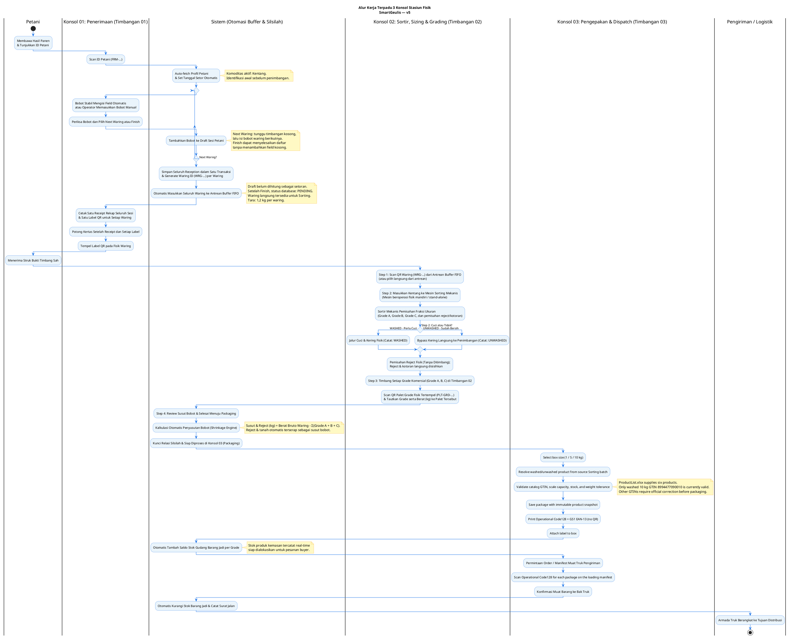

# Diagram Alur Kerja — Proses Pengemasan Kentang
## Pendataan Digital Terpadu & Lokasi-Berbasis Wadah

---

## 1. Diagram Alur Kerja (Workflow)

---

## Deskripsi Rinci Alur Kerja (3 Konsol Terpadu Berbasis 3 Timbangan Fisik)

Sistem tata kelola pengemasan kentang SmartGeulis menyederhanakan alur operasional ke dalam **3 Konsol Stasiun Fisik** yang masing-masing terhubung langsung (*1:1 hardware mapping*) dengan unit timbangan digital:

### 1. Konsol 01: Penerimaan & Waring Intake — *Area Intake (Timbangan 01)*
- **Perangkat Keras**: Timbangan Lantai RS485 kapasitas 150 kg, barcode scanner, dan printer thermal IW-J300H 80 mm Ethernet untuk Reception.
- **Fungsi**: Operator memindai ID petani sekali, lalu menimbang setiap waring. Bobot stabil otomatis mengisi field; input manual tetap tersedia. **Next Waring** menambahkan bobot ke draft dan menyiapkan waring berikutnya. **Finish** menambahkan bobot terakhir yang valid, menyimpan seluruh sesi, dan mencetak.
- **Otomasi Sistem**:
  1. Menyimpan sesi secara atomik dan idempoten saat **Finish**, menerbitkan kode `WRG-...` unik per waring, dan memasukkan waring ke antrean FIFO. Draft belum dihitung pada dashboard petani.
  2. Mencetak satu receipt rekap bruto/tara/neto seluruh sesi dan satu label QR per waring berisi identitas petani serta berat bruto. Kertas dipotong setelah receipt dan setiap label. Tara tetap 1,2 kg per waring.
- **Keunggulan**: Memangkas waktu tunggu petani di gerbang penerimaan (*zero truck queue*) dan mengunci identitas waring sejak hulu tanpa perlu pencatatan manual.

### 2. Konsol 02: Sortir, Sizing, Cuci & Grading Mutu — *Area Sortir & Grading (Timbangan 02)*
- **Perangkat Keras**: Timbangan Lantai RS485 kapasitas 100 kg, barcode scanner 2D. (Mesin sortir mekanis dan unit cuci/pengering beroperasi secara fisik mandiri / *stand-alone*; sistem web murni bertindak sebagai pencatat / *recorder* data proses).
- **Fungsi Terpadu (Proses Sekuensial 4 Langkah)**:
  1. *Step 1: Scan QR Waring*: Operator memindai QR code waring intake (`WRG-...`) atau memilih dari antrean buffer FIFO. Sistem memuat identitas petani asal, desa, dan berat bruto intake waring.
  2. *Step 2: Sizing & Wash*: Operator menuangkan umbi kentang ke mesin Sorting fisik, lalu mencatat `WASHED` atau `UNWASHED`.
  3. *Step 3: Weigh Grades*: Operator mencatat bobot aktual atau 0 kg untuk Grade A, B, dan C, lalu mengaitkan setiap grade berbobot ke palet fisik terdaftar.
  4. *Step 4: Review & Save*: Sistem menampilkan bobot bruto, total grade, susut, dan yield. Operator mengonfirmasi hasil sebelum data disimpan dan palet tersedia untuk Packaging.
     $$\text{Susut (kg)} = \text{Berat Bruto Intake Waring} - \sum (\text{Berat Bersih Grade A + B + C})$$
     $$\text{Persentase Susut (\%)} = \left(\frac{\text{Susut (kg)}}{\text{Berat Bruto Intake Waring}}\right) \times 100\%$$
- **Keunggulan**: Mengadopsi workflow sekuensial terarah seperti Konsol 01 yang mencegah kesalahan tahapan operator di lapangan (*poka-yoke*), tanpa kerumitan kontrol mesin di aplikasi web, dan tanpa pencetakan stiker palet baru.

### 3. Konsol 03: Pengepakan, Gudang Jadi & Dispatch — *Area Pengepakan & Pengiriman (Timbangan 03)*
- **Perangkat Keras**: Timbangan Meja Presisi RS485 kapasitas 30 kg, printer thermal IW-J300H 80 mm Ethernet untuk Packaging, dan wireless barcode scanner pengiriman.
- **Fungsi Terpadu**:
  1. **Box Packaging**: 1, 5, and 10 kg boxes. Tolerance: ±5 g for 1 kg; ±50 g for 5/10 kg. Washed/unwashed follows the source Sorting batch.
  2. **Packaging Labels**: Exactly two symbols: Operational Code128 (unique package code) and GS1 EAN-13 (catalog GTIN). No QR. Invalid GTINs block saving and printing before inventory changes. Reprints use the saved product snapshot; historical packages without one cannot print a GS1 label.
  3. *Penanganan Sisa Palet & Pelepasan (*Close & Release*)*: Jika sisa stok palet lebih kecil dari target kemasan saat ini ($\ge 1\text{ kg}$), operator disarankan menurunkan ukuran kemasan (mis. $10\text{ kg} \rightarrow 5\text{ kg} / 1\text{ kg}$). Sisa $\le 0{,}05\text{ kg}$ dilepas otomatis sebagai toleransi penimbangan, sedangkan sisa di bawah $1\text{ kg}$ (atau sisa yang tidak dikemas) diselesaikan melalui **Close & Release Pallet** dengan pencatatan disposisi audit (`SHRINKAGE_LOSS`, `LOOSE_RESERVE`, `CULL_REJECT`, `SAMPLE_USE`) agar palet fisik langsung kembali berstatus `AVAILABLE` untuk digunakan ulang di Konsol 02.
  4. *Otomasi Saldo Gudang Jadi*: Kemasan yang selesai diberi label otomatis menambah saldo inventori barang jadi per grade (*Finished Goods Ledger*).
  5. *Verifikasi Muat Truk (*Dispatch Scan*)*: Operator memilih grade dan jumlah unit untuk manifest, lalu memindai setiap kode kemasan yang dialokasikan. Keberangkatan dapat dikonfirmasi setelah seluruh unit terverifikasi; stok gudang berkurang saat armada diberangkatkan.
- **Keunggulan**: Mengintegrasikan proses pengemasan presisi dengan pencatatan inventori barang jadi dan kepatuhan manifest logistik ekspor tanpa disparitas data.

---

## Ringkasan Standar Identifikasi & Barcode

| Wadah / Dokumen | Jenis Barcode | Standar | Fungsi |
|-----------------|--------------|---------|--------|
| ID Petani | QR Code | Internal | Identifikasi petani saat proses intake (`FRM-YYYY-SEQ`) |
| Struk Timbang Petani | Nota Thermal | Fisik | Tanda terima sah setoran bruto petani |
| Waring Intake | QR Code / Barcode | Internal | Identitas waring intake di area penerimaan & buffer (`WRG-YYYYMMDD-SEQ`) |
| Palet Sortir | QR Code | Internal | Wadah agregasi hasil sortir manual (`PLT-YYYYMMDD-SEQ`) |
| Palet Grade Fisik | QR Code Tertempel | Internal | QR permanen pada palet grade (`PLT-GRD-A-...`), operator scan & tautkan (tanpa cetak) |
| Box 1/5/10 kg | Code128 | Internal | Unique package code for operational scanning |
| Box 1/5/10 kg | EAN-13 | GS1 | Product GTIN from ProductList.xlsx; validated check digit |

---

## 2. Diagram Arsitektur Sistem

```plantuml
@startuml Arsitektur_Sistem

skinparam rectangleBorderColor #1A73E8
skinparam rectangleBackgroundColor #FAFAFA
skinparam nodeBorderColor #1A73E8
skinparam nodeBackgroundColor #EAF4FB
skinparam componentBorderColor #0D47A1
skinparam componentBackgroundColor #FFFFFF
skinparam databaseBorderColor #F9A825
skinparam databaseBackgroundColor #FFF9C4
skinparam arrowColor #1A73E8
skinparam defaultFontName Arial
skinparam defaultFontSize 11

title Arsitektur Sistem Tata Kelola Pengemasan Kentang (5 Layer)

' ============================================================
' LAYER 1 — FIELD LEVEL
' ============================================================
rectangle "**[ FIELD LEVEL ]**\nPerangkat Lapangan, Sensor, & Aktuator IoT" as FL #FFEBEE {

  rectangle "Area Penerimaan (Intake)" as area_recv #FFCDD2 {
    component [Timbangan Intake RS485\n(Gross Waring)] as scale_intake
    component [Scanner QR\n(ID Petani)] as scan_farmer
    component [Printer Struk Thermal\n(Nota Petani)] as print_receipt
    component [Printer Label\n(QR Waring WRG-…)] as print_waring
  }

  rectangle "Warehouse — Zona Buffer (Waiting)" as area_buf #FFCDD2 {
    component [Scanner In/Out\nWaring Buffer] as scan_buffer
  }

  rectangle "Area Sortir Manual & Paletisasi" as area_sort_manual #FFCDD2 {
    component [Scanner Barcode\n(Pairing Waring ↔ Palet)] as scan_pairing
  }

  rectangle "Area Sortir Mekanis & Washer" as area_machine #FFCDD2 {
    component [Mesin Sortir Mekanis\n(Roller/Sizer)] as machine_sizer
    component [Unit Pencucian & Pengering\n(Kondisional)] as machine_washer
  }

  rectangle "Area Grading & Timbang Susut" as area_grading #FFCDD2 {
    component [Timbangan Grading RS485\n(Net Grade & Shrinkage)] as scale_grading
    component [Printer Label Grade\n(GRD-…)] as print_grade
  }

  rectangle "Area Pengepakan (Packaging)" as area_pack #FFCDD2 {
    component [Timbangan Pouch RS485\n(Target 1 kg / Bulk)] as scale_pouch
    component [Printer Label Produksi & Ekspor\n(Operational Code128 / GS1 EAN-13)] as print_pack
  }

  rectangle "Warehouse — Zona Barang Jadi" as area_wh_fg #FFCDD2 {
    component [Scanner In/Out\nBarang Jadi] as scan_fg
  }

  rectangle "Area Pengiriman (Delivery)" as area_ship #FFCDD2 {
    component [Scanner Dispatch\nVerifikasi Manifest Truk] as scan_dispatch
    component [Delivery Truck] as truck
  }
}

' ============================================================
' LAYER 2 — EDGE / GATEWAY LEVEL
' ============================================================
rectangle "**[ EDGE / GATEWAY LEVEL ]**\nAkuisisi Data Sensor & Gateway Komunikasi" as EGL #F3E5F5 {

  node "Node MCU #1\n(Area Penerimaan)" as mcu1 {
    component [Firmware ESP32 #1\nModbus TCP Server :502] as fw1
  }

  node "Node MCU #2\n(Area Grading)" as mcu2 {
    component [Firmware ESP32 #2\nModbus TCP Server :502] as fw2
  }

  node "Node MCU #3\n(Area Pengepakan)" as mcu3 {
    component [Firmware ESP32 #3\nModbus TCP Server :502] as fw3
  }

  node "Switch / Router Jaringan Lokal\n(LAN & Wi-Fi Industri)" as router
}

' ============================================================
' LAYER 3 — APPLICATION LEVEL (LOCAL SERVER)
' ============================================================
rectangle "**[ APPLICATION LEVEL ]**\nServer Operasional Terpusat Fasilitas" as AL #FFF3E0 {

  node "PC Server Fasilitas\n(Ubuntu Linux Local Server)" as pc {
    component [Web Server Nginx\n(Reverse Proxy)] as web
    component [Backend Core App\n(Modular Monolith)] as app
    component [Modbus TCP Master\n/ Polling Client] as mb_client
    component [WebSocket Server\n(Socket.io Real-Time)] as ws_server
    component [Session Context &\nWaring Linkage Manager] as ctx
    component [Shrinkage Calculation Engine] as shrinkage_eng
    component [GS1 Digital Link Resolver\n& Traceability Engine] as trace_resolver
    database "PostgreSQL Database\n(Local Operational Data)" as local_db
  }
}

' ============================================================
' LAYER 4 — CLOUD LEVEL
' ============================================================
rectangle "**[ CLOUD LEVEL ]**\nSinkronisasi Data, Cadangan, & Disaster Recovery" as CL #E3F2FD {
  node "Cloud Infrastructure" as cloud {
    database "Cloud DB Backup\n(Periodic Data Synchronization)" as cloud_db
  }
}

' ============================================================
' LAYER 5 — ENTERPRISE LEVEL
' ============================================================
rectangle "**[ ENTERPRISE LEVEL ]**\nHak Akses Pengguna Terpadu (RBAC 3-Role) & Konsumen Publik" as ENT #E8F5E9 {

  node "Gateway Internet / Domain Publik" as internet {
    component [HTTPS Domain\n(trace.smartgeulis.id)] as domain
  }

  actor "Admin\n(Hak Akses Penuh)" as admin
  actor "Operator Terpadu\n(Multi-Menu Workstation)" as operator
  actor "Petani\n(Portal Mandiri)" as farmer_user
  actor "Konsumen / Buyer\n(Scan QR Publik)" as consumer
}

' ============================================================
' KONEKSI ANTAR PERANGKAT & LAYER
' ============================================================

' Field RS485 → MCU Edge
scale_intake  --> mcu1 : RS485 / Modbus RTU
scale_grading --> mcu2 : RS485 / Modbus RTU
scale_pouch   --> mcu3 : RS485 / Modbus RTU

' MCU Edge (Modbus TCP Server :502) <--> Router
mcu1 <--> router : Modbus TCP (:502) / LAN
mcu2 <--> router : Modbus TCP (:502) / LAN
mcu3 <--> router : Modbus TCP (:502) / LAN

' Field Scanners & Printers → Router (USB/LAN)
scan_farmer   --> router : USB / LAN
print_receipt --> router : USB / LAN
print_waring  --> router : USB / LAN
scan_buffer   --> router : Wi-Fi / LAN
scan_pairing  --> router : Wi-Fi / LAN
print_grade   --> router : USB / LAN
print_pack    --> router : USB / LAN
scan_fg       --> router : Wi-Fi / LAN
scan_dispatch --> router : Wi-Fi / LAN

router <--> pc : TCP/IP (LAN)

' Komponen Internal PC Server
web <--> app
app <--> mb_client
app <--> ws_server
app <--> local_db
app <--> ctx
app <--> shrinkage_eng
app <--> trace_resolver
ctx <--> local_db
shrinkage_eng <--> local_db
mb_client --> ws_server : Broadcast Live Weight (Socket.io)

' Sync ke Cloud
local_db --> cloud_db : Sinkronisasi Terjadwal (HTTPS)

' Server ke Domain Internet
web --> domain : Reverse Proxy (HTTPS)

' Akses Pengguna (RBAC 3-Role + Publik)
domain --> admin       : RBAC: ADMIN (Full Control)
domain --> operator    : RBAC: OPERATOR (Akses Semua Menu Stasiun Kerja)
domain --> farmer_user : RBAC: FARMER (Riwayat Setor, Timbang, & Grade)
domain --> consumer    : Publik Tanpa Login (GS1 Traceability Pouch)

@enduml
```

---

## Konfigurasi Register Timbangan

Setiap stasiun menyimpan konfigurasi Modbus TCP secara terpisah di `scale_settings`: alamat perangkat, port, Unit ID, kapasitas, Weight Start Register, dan Status Register. Backend membentuk window pembacaan FC03 dari alamat yang tersimpan; perubahan melalui Settings berlaku langsung tanpa restart backend.

| Konfigurasi | Rentang | Default firmware |
|-------------|---------|------------------|
| Unit ID | `1–247` | `1` |
| Weight Start Register | `40001–40030`, `FLOAT32` dua word | `40001` (live) atau `40003` (stable) |
| Status Register | `40001–40031`, `UINT16` | `40011` |

Status stabil dibaca dari bit `0x0010` pada Status Register yang dikonfigurasi. Alamat `40002` adalah word kedua dari nilai berat `FLOAT32` pada `40001–40002`, bukan status register.

---

## Manajemen Akses Pengguna (RBAC 3-Role + Publik)

Sistem menyederhanakan hak akses menjadi **3 peran pengguna terautentikasi** ditambah **1 akses publik tanpa autentikasi**:

| Role | Kategori | Hak Akses & Cakupan Antarmuka |
|------|----------|-------------------------------|
| **ADMIN** | Akun Internal | Akses penuh (*Full Access*) untuk konfigurasi master data (komoditas, grade, packaging), manajemen pengguna & petani, audit trail sistem, pengaturan harga, serta analitik yield pabrik. |
| **OPERATOR** | Akun Internal | **Akun Operasional Tunggal (*Unified Operator Account*)**. Satu akun operator memiliki akses ke seluruh modul lapangan melalui **Menu Pemilih Stasiun Kerja (*Workstation Selector*)**: 1. *Penerimaan (Intake)*: Scan petani, timbang bruto waring, approve berat, cetak struk nota & label waring. 2. *Gudang Penyangga (Waiting Buffer)*: Kontrol antrean waring mentah (FIFO). 3. *Sortir Manual & Pairing*: Pembersihan kotoran fisik kasar, masukkan ke palet ber-QR, dan scan pairing waring $\leftrightarrow$ palet. 4. *Mesin Sortir & Cuci*: Monitoring alat sortir mekanis dan status pencucian. 5. *Grading & Timbang Susut*: Timbang net per grade (A/B/C/Reject), visualisasi kalkulasi penyusutan real-time. 6. *Pengepakan*: Weigh 1/5/10 kg boxes and print Operational Code128 + GS1 EAN-13 without QR. 7. *Gudang Barang Jadi & Dispatch*: Manajemen stok produk jadi dan scan verifikasi muatan truk. |
| **FARMER** (Petani) | Akun Eksternal | Portal mandiri petani untuk melihat riwayat setoran waring, status timbangan intake, nota digital, serta transparansi laporan grading dan persentase penyusutan. |
| **KONSUMEN / BUYER** | Publik (Tanpa Login) | Packaging labels contain no public QR. The product GTIN identifies the catalog item; the unique operational code identifies each package. |

---

## 3. Diagram Skema Database

```plantuml
@startuml Database_Schema

skinparam BackgroundColor #FAFAFA
skinparam ArrowColor #1A73E8
skinparam ArrowFontName Arial
skinparam DefaultFontName Arial
skinparam DefaultFontSize 11

title Skema Database Relasional — SmartGeulis\n(Waring Intake, Pairing Palet, Timbang Susut, & Dual Warehouse)

' ============================================================
' CORE MODELS
' ============================================================

entity "User" as user {
  *id : UUID <<PK>>
  --
  *email : VARCHAR <<UNIQUE>>
  *name : VARCHAR
  *password : VARCHAR
  *role : ENUM <<ADMIN, OPERATOR, FARMER>>
  createdAt : TIMESTAMP
  updatedAt : TIMESTAMP
}

entity "Farmer" as farmer {
  *id : UUID <<PK>>
  --
  *code : VARCHAR <<UNIQUE>> <<FRM-YYYY-SEQ>>
  *name : VARCHAR
  phone : VARCHAR
  address : TEXT
  location : VARCHAR
  *userId : UUID <<FK>>
  createdAt : TIMESTAMP
  updatedAt : TIMESTAMP
}

entity "Commodity" as commodity {
  *id : UUID <<PK>>
  --
  *code : VARCHAR <<UNIQUE>> <<001: Kentang>>
  *name : VARCHAR <<UNIQUE>>
  description : TEXT
  *unit : VARCHAR <<DEFAULT: kg>>
  createdAt : TIMESTAMP
}

entity "Waring" as waring {
  *id : UUID <<PK>>
  --
  *code : VARCHAR <<UNIQUE>> <<WRG-YYYYMMDD-SEQ>>
  *farmerId : UUID <<FK>>
  *commodityId : UUID <<FK>>
  *initialWeightKg : FLOAT
  *status : ENUM <<BUFFER_WAITING, IN_SORTING, COMPLETED>>
  receivedAt : TIMESTAMP
  verifiedBy : UUID <<FK>>
  createdAt : TIMESTAMP
}

entity "Pallet" as pallet {
  *id : UUID <<PK>>
  --
  *code : VARCHAR <<UNIQUE>> <<PLT-YYYYMMDD-SEQ>>
  *commodityId : UUID <<FK>>
  *status : ENUM <<IN_SORTING, GRADED, PACKED, SHIPPED>>
  createdAt : TIMESTAMP
}

entity "PalletWaring" as pallet_waring {
  *id : UUID <<PK>>
  --
  *palletId : UUID <<FK>>
  *waringId : UUID <<FK>>
  associatedAt : TIMESTAMP
  associatedBy : UUID <<FK>>
}

entity "Grade" as grade {
  *id : UUID <<PK>>
  --
  *name : VARCHAR <<UNIQUE>> <<Grade A, B, C, Reject>>
  description : TEXT
  *commodityId : UUID <<FK>>
  createdAt : TIMESTAMP
}

entity "GradingRecord" as grading_record {
  *id : UUID <<PK>>
  --
  *palletId : UUID <<FK>>
  *gradeId : UUID <<FK>>
  *netWeightKg : FLOAT
  shrinkageKg : FLOAT
  shrinkagePercentage : FLOAT
  recordedAt : TIMESTAMP
  *operatorId : UUID <<FK>>
}

entity "WeighingRecord" as weighing {
  *id : UUID <<PK>>
  --
  *stage : ENUM <<INTAKE, GRADING, PACKAGING>>
  referenceId : UUID
  *weightKg : FLOAT
  note : TEXT
  recordedAt : TIMESTAMP
  *userId : UUID <<FK>>
}

entity "Pouch" as pouch {
  *id : UUID <<PK>>
  --
  *palletId : UUID <<FK>>
  *gradeId : UUID <<FK>>
  *operationalCode : VARCHAR <<UNIQUE>> <<Code128>>
  *ean13 : VARCHAR <<Product GTIN; shared by product>>
  *weightKg : FLOAT <<DEFAULT: 1.0>>
  *commodityId : UUID <<FK>>
  createdAt : TIMESTAMP
}

entity "Warehouse" as warehouse {
  *id : UUID <<PK>>
  --
  *name : VARCHAR
  *zone : ENUM <<BUFFER_WAITING, FINISHED_GOODS>>
  *capacity : INT
  createdAt : TIMESTAMP
  updatedAt : TIMESTAMP
}

entity "WarehouseStock" as stock {
  *id : UUID <<PK>>
  --
  *warehouseId : UUID <<FK>>
  gradeId : UUID <<FK>>
  *itemType : ENUM <<RAW_WARING, FINISHED_POUCH, FINISHED_BOX>>
  *quantity : INT
  *totalWeight : FLOAT
  createdAt : TIMESTAMP
  updatedAt : TIMESTAMP
}

' ============================================================
' PACKAGING & DELIVERY MODELS
' ============================================================

entity "PackagingType" as pkg_type {
  *id : UUID <<PK>>
  --
  *code : VARCHAR <<UNIQUE>> <<CARTON, BOX, SACK>>
  *name : VARCHAR
  createdAt : TIMESTAMP
}

entity "PackagingSize" as pkg_size {
  *id : UUID <<PK>>
  --
  *typeId : UUID <<FK>>
  *code : VARCHAR <<UNIQUE>> <<10KG, 50KG, STD>>
  *name : VARCHAR
  *capacity : INT
  createdAt : TIMESTAMP
}

entity "PackagingUnit" as pkg_unit {
  *id : UUID <<PK>>
  --
  *sizeId : UUID <<FK>>
  *barcode : VARCHAR <<UNIQUE>> <<Operational Code128>>
  productSnapshot : JSON <<GTIN, product, box size, wash status>>
  batchNo : VARCHAR
  totalWeight : FLOAT
  *commodityId : UUID <<FK>>
  *status : VARCHAR <<DEFAULT: ACTIVE>>
  createdAt : TIMESTAMP
}

entity "PackagingItem" as pkg_item {
  *id : UUID <<PK>>
  --
  *packagingId : UUID <<FK>>
  *itemId : VARCHAR
  *itemType : VARCHAR <<POUCH, UNIT>>
  createdAt : TIMESTAMP
}

entity "Delivery" as delivery {
  *id : UUID <<PK>>
  --
  *truckPlate : VARCHAR
  *destination : VARCHAR
  driverName : VARCHAR
  *commodityId : UUID <<FK>>
  departedAt : TIMESTAMP
  createdAt : TIMESTAMP
}

entity "PackagingDelivery" as pkg_delivery {
  *id : UUID <<PK>>
  --
  *packagingId : UUID <<FK>>
  *deliveryId : UUID <<FK>>
  createdAt : TIMESTAMP
}

entity "ScaleReading" as scale {
  *time : TIMESTAMP <<PK>>
  *deviceId : VARCHAR <<PK>>
  --
  *stage : ENUM <<INTAKE, GRADING, PACKAGING>>
  weightKg : FLOAT
  referenceCode : VARCHAR
  raw : JSON
}

' ============================================================
' HUBUNGAN RELASIONAL ENTITAS
' ============================================================

user ||--o| farmer : "profile akun"
farmer ||--o{ waring : "menyetor waring"
commodity ||--o{ waring : "memiliki jenis"
commodity ||--o{ pallet : "memiliki jenis"
commodity ||--o{ grade : "memiliki jenis"
commodity ||--o{ pouch : "memiliki jenis"

waring ||--o{ pallet_waring : "dikelompokkan ke"
pallet ||--o{ pallet_waring : "memuat waring"

pallet ||--o{ grading_record : "hasil grading"
grade ||--o{ grading_record : "diklasifikasikan"
pallet ||--o{ pouch : "dikemas menjadi"
grade ||--o{ pouch : "mutu pouch"

warehouse ||--o{ stock : "menyimpan stok"
grade ||--o{ stock : "stok per grade"

pouch ||--o{ pkg_item : "dimasukkan ke"
pkg_type ||--o{ pkg_size : "memiliki ukuran"
pkg_size ||--o{ pkg_unit : "menghasilkan unit"
pkg_unit ||--o{ pkg_item : "berisi"
pkg_unit ||--o{ pkg_delivery : "dikirim via"
delivery ||--o{ pkg_delivery : "memuat pengiriman"

user ||--o{ weighing : "mencatat timbangan"
user ||--o{ grading_record : "mencatat grading"

@enduml
```

---

## Standar Kodefikasi & Barcode

Semua entitas fisik lapangan menggunakan standar identifier berikut:

1. **Farmer Code (`FRM-{YYYY}-{SEQ}`)**:
   - Contoh: `FRM-2026-0001`
   - Dicetak sebagai QR Code pada kartu ID Petani.
2. **Waring Code (`WRG-{YYYYMMDD}-{SEQ}`)**:
   - Contoh: `WRG-20261025-0001`
   - Diterbitkan sistem pasca-penimbangan penerimaan; dicetak dan ditempelkan pada wadah waring.
3. **Pallet Code (`PLT-{YYYYMMDD}-{SEQ}`)**:
   - Contoh: `PLT-20261025-0001`
   - Diterbitkan saat kentang hasil sortir manual dimasukkan ke palet; menjadi wadah induk untuk proses mekanis dan grading.
4. **Grade Label (`GRD-{PALLET_CODE}-{GRADE}`)**:
   - Contoh: `GRD-PLT-20261025-0001-A`
   - Penanda fisik wadah hasil grading per mutu.
5. **Operational Packaging Barcode (Code128)**:
   - Example: `EXP-20261115-0001`. Unique per box and used for dispatch verification.
6. **GS1 Product Barcode (EAN-13)**:
   - Product GTIN is copied verbatim from `docs/ProductList.xlsx` and validated before saving.
   - Six products: washed/unwashed boxes in 1, 5, and 10 kg sizes. Only `001` (`8994477090010`, washed 10 kg) currently passes the check digit.
   - Correct invalid official GTINs through a catalog migration; never invent or silently repair identifiers.
   - `package_units.productSnapshot` preserves product number, GTIN, brand, product name, box size, and wash status. Reprints do not derive identity from reused pallets or edited catalog rows.
   - Packaging uses no QR. Reception, pallet, and farmer identification remain unchanged.

---

## 4. Spesifikasi & Ruang Lingkup MVP (Minimum Viable Product)

### A. Sasaran MVP
- **Jangka Waktu**: 4--6 minggu menuju go-live operasional packhouse.
- **Komoditas**: Kentang tunggal (Grade A, B, C, Reject).
- **Tujuan Utama**: Digitalisasi penuh penerimaan waring, eliminasi sengketa susut melalui penimbangan transparan, validasi alur sortir & pairing palet, serta penerbitan label kemasan Operational Code128 dan GS1 EAN-13.

### B. Matriks Ruang Lingkup (In-Scope vs. Out-of-Scope)

| Kategori | Rincian Fitur & Komponen |
|----------|--------------------------|
| **In-Scope (Fitur Inti MVP)** | 1. **Penerimaan Waring**: Scan ID petani (`FRM`), timbang bruto RS485, approve berat, cetak struk nota tanda terima thermal, dan cetak label QR waring (`WRG`). 2. **Gudang Penyangga (Waiting Buffer)**: Kontrol antrean waring FIFO di zona penyangga gudang. 3. **Sortir Manual & Pairing**: Pembersihan fisik kasar & scan pairing QR Waring $\leftrightarrow$ QR Palet (`PLT`) untuk menjaga silsilah asal petani. 4. **Mesin Sortir & Cuci**: Pencatatan parameter operasional sortir mekanis dan opsi pencucian/pengeringan kondisional. 5. **Grading & Timbang Susut**: Timbangan IoT RS485 per grade dan kalkulasi penyusutan otomatis ($\text{Susut} = \text{Bruto Waring} - \sum \text{Net Grade}$). 6. **Pengepakan Retail & Ekspor**: Box 1/5/10 kg, immutable product snapshots, and two barcodes (Operational Code128 + GS1 EAN-13), without QR. 7. **Gudang Barang Jadi & Dispatch**: Kontrol stok per grade dan scan verifikasi manifest pengiriman truk. 8. **RBAC 3-Role Terpadu**: Akun `ADMIN`, akun `OPERATOR` dengan menu modular pemilih stasiun kerja (*workstation selector*), akun `FARMER`, dan akses publik `KONSUMEN`. 9. **Infrastruktur Local-First**: Server Ubuntu lokal (Go REST API, PostgreSQL, dan Modbus TCP over Ethernet) dengan ketahanan jaringan saat internet padam. |
| **Out-of-Scope (Fase Lanjutan)** | 1. Komoditas multi-varietas (Tomat, Cabai) — skema DB ready, implementasi MVP fokus pada Kentang. 2. Pembayaran digital / e-wallet petani langsung dari aplikasi. 3. Computer Vision / AI automatic optical grading. 4. Aplikasi mobile native toko aplikasi (Play Store / App Store) — antarmuka berjalan responsif via peramban web/PWA. 5. Konveyor PLC otomatisasi robotik. |

### C. Milestone 6 Fase Implementasi

1. **Fase 0 (Minggu 1)**: Setup server lokal, Docker Compose, migrasi SQL Go (`Waring`, `PalletWaring`, `GradingRecord`, dual warehouse zone), seed master data.
2. **Fase 1 (Minggu 1--2)**: Autentikasi JWT, middleware RBAC 3-role (Admin, Operator, Farmer), CRUD Petani & cetak kartu QR `FRM`.
3. **Fase 2 (Minggu 2--3)**: Layanan Waring Intake, driver Modbus RS485 timbangan penerimaan, dua printer thermal IW-J300H 80 mm melalui Ethernet untuk Reception dan Packaging, cetak struk nota thermal & label waring `WRG`, kontrol FIFO antrean buffer.
4. **Fase 3 (Minggu 3--4)**: Antarmuka scan pairing Waring $\leftrightarrow$ Palet `PLT`, form parameter mesin sortir & cuci kondisional, validasi upstream traceability.
5. **Fase 4 (Minggu 4)**: Driver timbangan IoT Area Grading, modul GradingRecord & Shrinkage Engine, dashboard visualisasi rendemen susut real-time.
6. **Fase 5 (Minggu 4--5)**: Box Packaging 1/5/10 kg, Operational Code128 and GS1 EAN-13 labels, validated product catalog.
7. **Fase 6 (Minggu 5--6)**: Gudang barang jadi, modul dispatch muatan truk, Socket.io real-time events, pengujian lapangan UAT.

